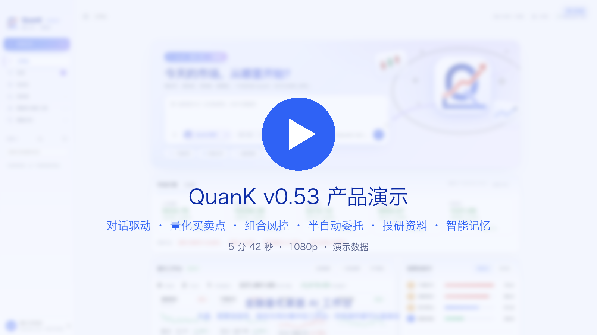
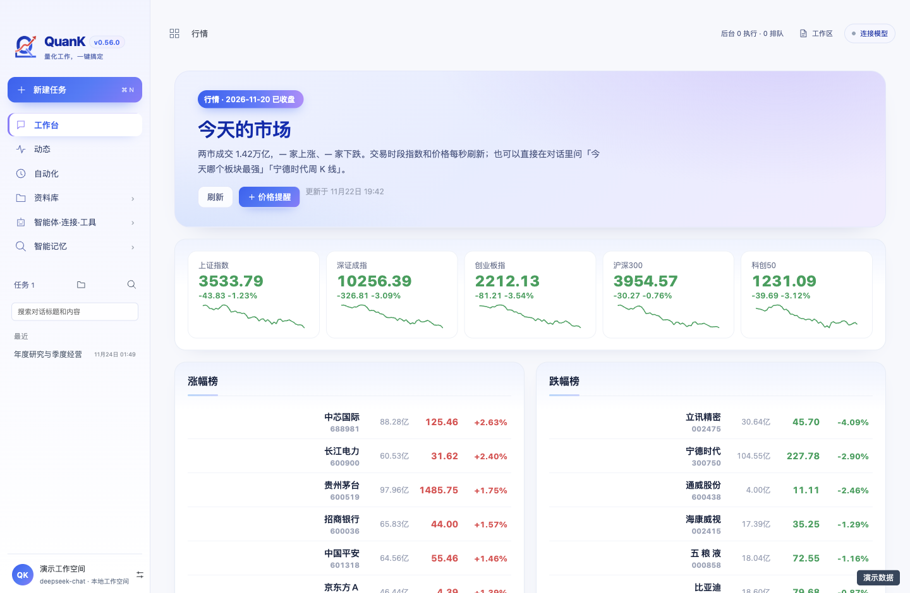
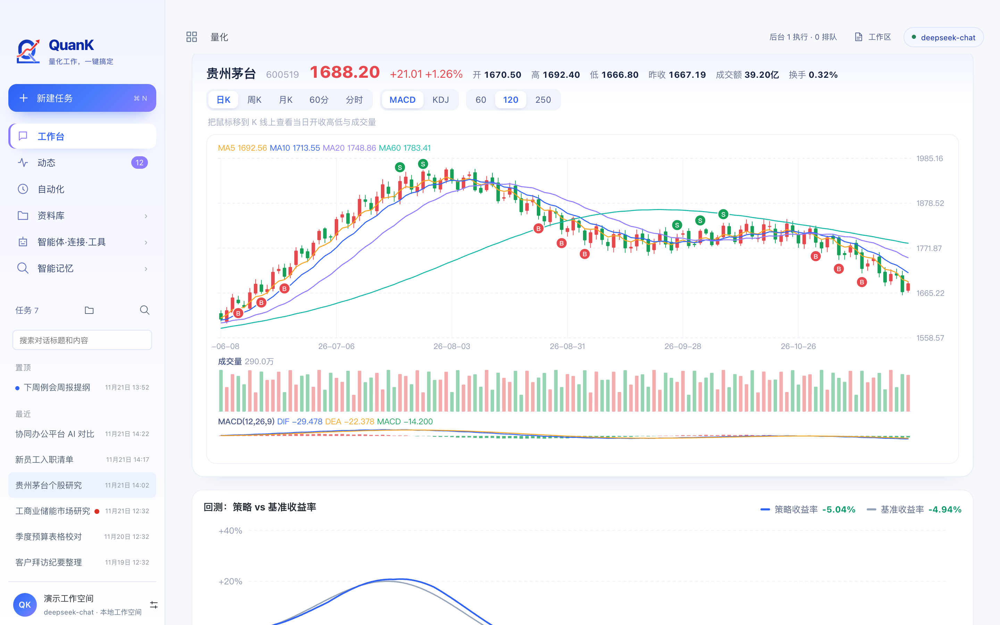
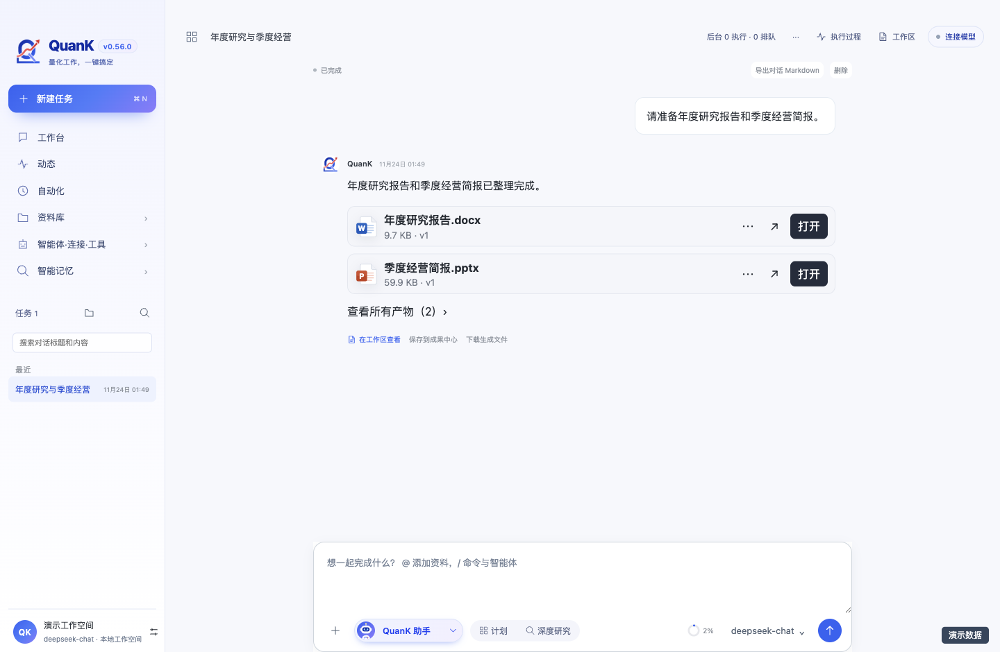
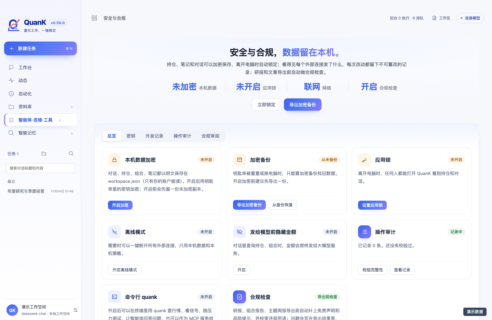
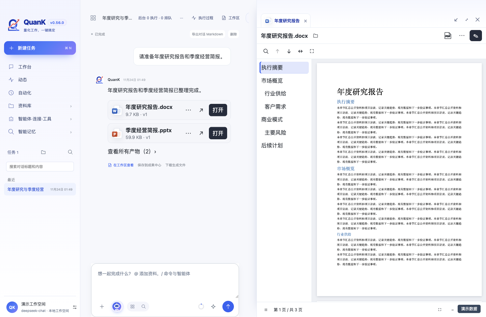
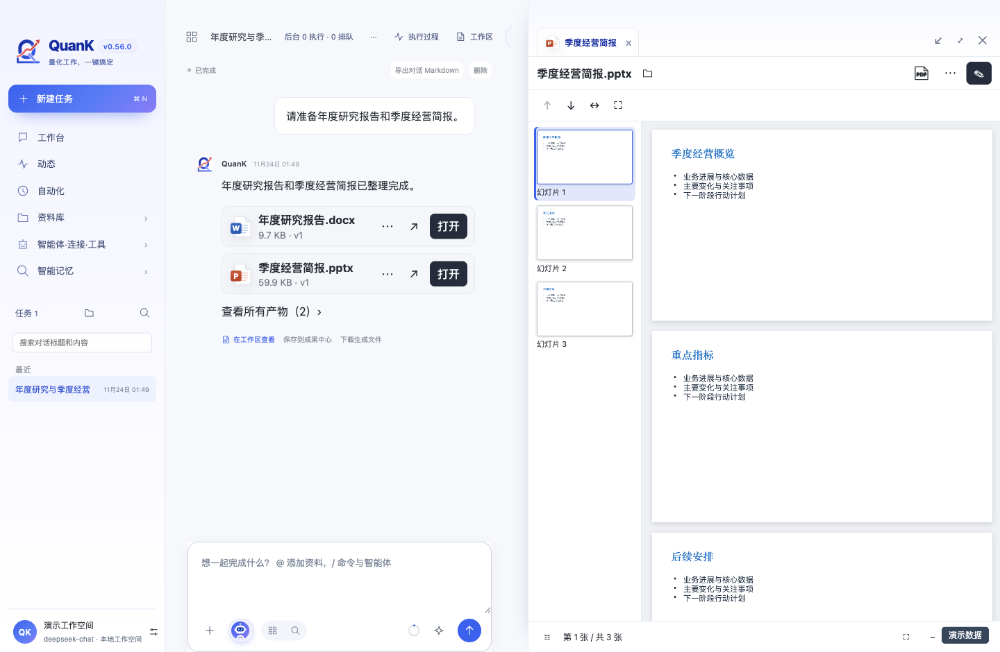
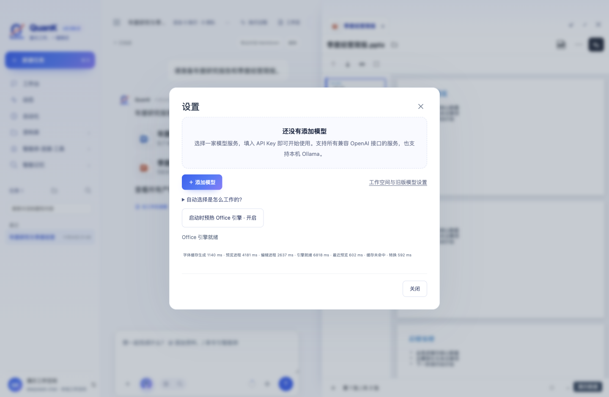
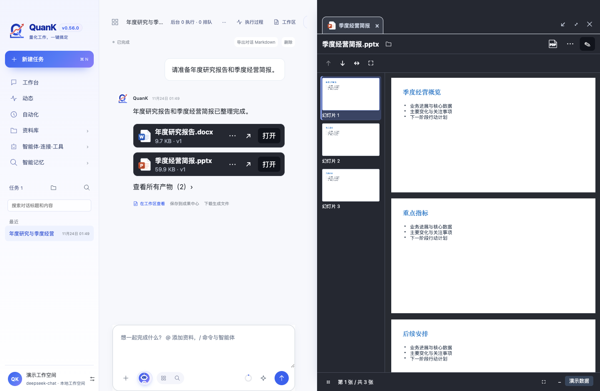

<div align="center">
  
  <h1>QuanK</h1>
  <p><b>量化工作，一键搞定</b></p>
  <p>本地优先的金融量化 Mac 工作台 · 你的策略，在你的电脑上跑</p>
  <p>
    
    
    
  </p>
  <p>
    <a href="https://github.com/scliubingxin/QuanK/releases/latest"><b>⬇ 下载 DMG</b></a> ·
    <a href="#一分钟看懂-quank">▶ 演示视频</a> ·
    <a href="#获取量化策略">获取量化策略</a> ·
    <a href="#核心能力">核心能力</a>
  </p>
</div>


## 一分钟看懂 QuanK

[](https://github.com/scliubingxin/QuanK/releases/download/v0.53.0/QuanK-v0.53-demo.mp4)

*点击封面下载 / 播放演示视频（1080p，含配音，约 133 MB）。全程用对话操作：加自选、记账、价格提醒、量化买卖点与回测、AI 研判与策略迭代建议、组合风控与压力测试、半自动委托（模拟盘）、动态提醒、投研资料与训练数据、智能体协作出研报、知识图谱与记忆。画面中的持仓与委托为演示数据。*

## 获取量化策略

<table>
<tr>
<td width="200"></td>
<td valign="middle">
<b>添加微信 <code>findingnoone</code></b><br><br>
获取量化策略、接入指导和使用支持。<br>
拿到策略后，在 QuanK「量化」页点「导入策略项目」即可开始使用。
</td>
</tr>
</table>

## 下载与安装

**系统要求**：Apple 芯片（M1 及以上）Mac，macOS 12 或更新版本。前往 [Releases](https://github.com/scliubingxin/QuanK/releases/latest) 下载最新的 `QuanK-v<版本>-mac-arm64.dmg`。

1. 双击 DMG，把 **QuanK** 拖到 **应用程序**。
2. 首次打开：在「应用程序」里右键 QuanK → 打开（只需一次）。
3. 左下角「模型设置」填入模型服务地址和 API Key（DeepSeek、通义、Kimi、本机 Ollama 均可）。

> 从 WillBuddy 升级：首次打开会自动迁移对话、记忆、任务和量化数据。

各版本更新内容见 [发布记录](docs/releases/README.md) 或 [GitHub Releases](https://github.com/scliubingxin/QuanK/releases)

## 核心能力

- **行情与分钟 K 线**：实时查看指数、个股报价和 1 / 5 / 15 / 30 分钟 K 线。
- **量化本地与远程引擎**：运行本地策略或连接远程引擎，查看股票池、策略信号与回测。
- **Coding 智能体**：通过本机 ACP 代理或内置编码能力迭代策略，审阅测试和回测对比后确认合并。
- **投研资料与知识库**：归档研报、公告和笔记，检索有出处的资料，查看财务趋势与公司关系。
- **组合与风控**：查看组合敞口和风险指标，运行压力测试与调仓模拟。
- **半自动委托**：生成委托并支持模拟撮合，真实委托由你在券商页面确认提交。
- **QuanK Office 编辑与预览**：编辑 Word / Excel / PowerPoint，在对话右侧分页预览并查看大纲。
- **页签内 Office 与 AI**：Word、PPT、Excel 打开即编辑，支持选区 AI、自动保存与版本历史。
- **安全与合规**：管理本机数据加密、凭据、外发记录、操作审计与导出审阅。
- **命令行与 MCP**：在终端调用行情、量化和投研工具，或用 MCP 接入其他客户端。

## 界面一览

| | |
| --- | --- |
|  |  |
|  |  |
|  |  |
|  |  |
|  |  |
|  |  |

## 隐私与安全

- **数据在本机**：对话、文档、持仓与量化数据保存在你的 Mac 上
- **密钥加密**：所有凭据用 macOS 钥匙串加密保存
- **逐次确认**：写文件、运行命令、记录成交等操作都先确认
- **不替你交易**：只读信号、记录成交，从不下单

## 常见问题

**需要另外安装 Office 或 Python 吗？** 文档引擎和 Python 运行时已内置。自定义技能需要的额外 Python 包可安装在系统 Python 中。

**量化策略从哪里来？** 添加微信 **findingnoone** 获取；QuanK 本身不附带任何策略。

**QuanK 会记住什么？** 你的偏好、关注方向，以及对话里出现的人物、公司和项目；都在「智能记忆」里，可随时编辑或删除。

**提示「无法验证开发者」？** 在「应用程序」里右键 QuanK → 打开，只需一次。

## 从源码运行

```bash
git clone https://github.com/scliubingxin/QuanK.git
cd QuanK/desktop && npm install && npm start
```

更多开发与打包说明见[桌面开发指南](desktop/README.md)。

## 许可与声明

源码以 [Apache License 2.0](LICENSE) 开源。私有量化策略不在本仓库中。QuanK 提供的信号、研判与报告仅供研究参考，不构成投资建议；投资有风险，决策请独立判断。

---

<sub><b>English</b> · QuanK is a local-first finance & quant workstation for Apple Silicon Macs: use a local or remote quant engine, use finance agents and research skills, connect market data, automate briefs and reports, and edit Word / Excel / PowerPoint files. Bring any OpenAI-compatible model. Licensed under Apache-2.0. <a href="https://github.com/scliubingxin/QuanK/releases/latest">Download</a></sub>
