<div align="center">
  
  <h1>QuanK</h1>
  <p><b>量化工作，一键搞定</b></p>
  <p>本地优先的金融量化 Mac 工作台 · 你的策略，在你的电脑上跑</p>
  <p>
    
    
    
  </p>
  <p>
    <a href="https://github.com/scliubingxin/QuanK/releases/latest"><b>⬇ 下载 DMG</b></a> ·
    <a href="#一分钟看懂-quank">演示视频</a> ·
    <a href="#获取量化策略">获取量化策略</a> ·
    <a href="#核心能力">核心能力</a>
  </p>
</div>


<table>
<tr>
<td width="20%" valign="top"><b>🖥 本机运行</b><br>策略、持仓、回测都在你的电脑上计算，策略代码不出本机</td>
<td width="20%" valign="top"><b>🤖 金融智能体</b><br>投研、建模、量化、风控 4 个智能体，11 个投研技能</td>
<td width="20%" valign="top"><b>📡 行情数据</b><br>A 股与全球行情、公司公告、财报数据，一句话接入</td>
<td width="20%" valign="top"><b>⏰ 自动盯盘</b><br>盘前晨报、收盘日报、信号变化即时提醒</td>
<td width="20%" valign="top"><b>🧠 智能记忆</b><br>知识图谱与记忆库，越用越懂你的投研习惯</td>
</tr>
</table>

## 一分钟看懂 QuanK

[](docs/media/quank-demo.mp4)

## 获取量化策略

<table>
<tr>
<td width="200"></td>
<td valign="middle">
<b>添加微信 <code>findingnoone</code></b><br><br>
获取量化策略、接入指导和使用支持。<br>
拿到策略后，在 QuanK「量化」页点「导入策略项目」即可开始使用。
</td>
</tr>
</table>

## 下载与安装

**系统要求**：Apple 芯片（M1 及以上）Mac，macOS 12 或更新版本。前往 [Releases](https://github.com/scliubingxin/QuanK/releases/latest) 下载 **`QuanK-v0.52.0-mac-arm64.dmg`**。

1. 双击 DMG，把 **QuanK** 拖到 **应用程序**。
2. 首次打开：在「应用程序」里右键 QuanK → 打开（只需一次）。
3. 左下角「模型设置」填入模型服务地址和 API Key（DeepSeek、通义、Kimi、本机 Ollama 均可）。

> 从 WillBuddy 升级：首次打开会自动迁移对话、记忆、任务和量化数据。

## 核心能力

### 量化工作台：在本机运行你的策略


- **一屏看全**：自选信号、持仓盈亏、近 60 日走势，股票池按综合分排行
- **个股详情**：档位与理由、因子得分、回测收益曲线
- **持仓与定投**：记录真实成交，调整定投节奏，QuanK 从不替你下单
- **盯盘与日报**：信号变化即时通知，收盘自动生成算法日报
- **一句话加自选**：在对话里说「添加宁德时代」，自动联网查代码、名称和公司标志
- **获取策略**：添加微信 **findingnoone**

| | |
| --- | --- |
| 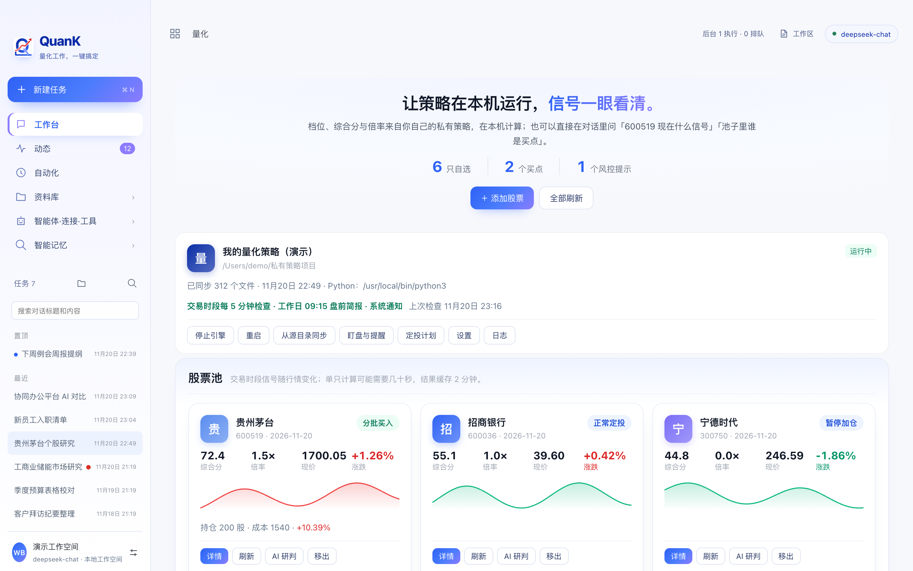 | 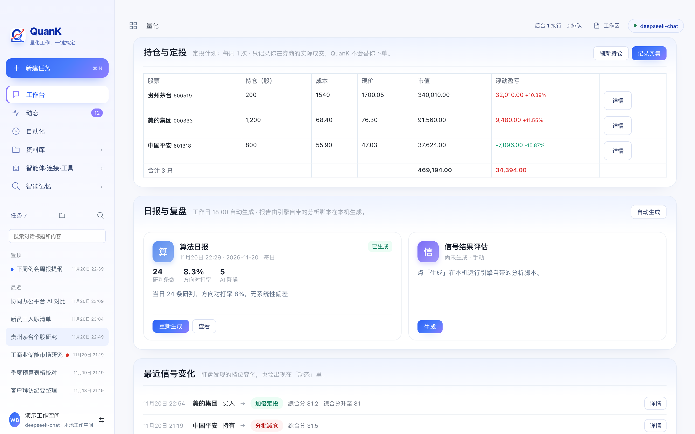 |
|  |  |

### 行情工作台：指数、板块与 K 线

- **大盘一屏看全**：首页「市场行情」卡片显示上证、深证、创业板、沪深300、科创50，以及涨跌家数、涨跌停数，交易时段每 10 秒刷新
- **行情页**：涨跌幅榜、行业 / 概念板块热力图（点开看成分股）、价格提醒
- **K 线图**：日 / 周 / 月 / 60 分钟 / 分时，均线、成交量、MACD、KDJ；量化详情页标出策略买卖点
- **自选股实时价**：股票池卡片显示实时价格，涨跌停与大幅异动自动提醒
- **一句话查行情**：「上证现在多少点」「今天哪个板块最强」「宁德时代周 K 线」「宁德时代涨超 5% 提醒我」

| | |
| --- | --- |
|  | 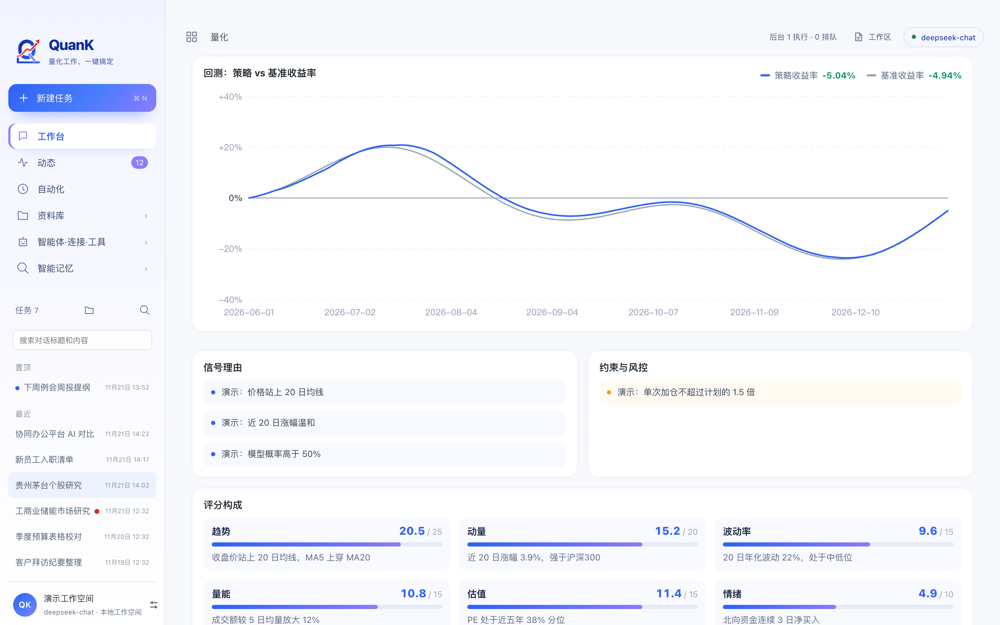 |

*左：个股 K 线，日 K 上标出回测买卖点——红 B 为买入、绿 S 为卖出，悬停显示日期、价格、股数与原因，切到周 K / 月 K 时买卖点自动对齐；右：回测收益率对比，智能定投（策略）与普通定投（基准）两条曲线同图对比，带 0% 基准线。*

### 投研文档：研报、公告与资料库

- **一句话研报**：说「给通威股份出一份研报」，或在个股页点「生成研报」，汇总本机量化信号与风控、回测、持仓、行情和近期公告，生成 Word / PPT / 网页并保存到成果中心；Word 版附 K 线与收益率图
- **公告解读**：自动拉取自选股公告，按风险事项、业绩预告、定期报告、股东变动、资本运作等分类并标注重要程度，摘录关键数字，可选 AI 解读，附交易所 PDF 原文
- **公告提醒**：工作日每 30 分钟检查股票池，重要公告进入「动态」并发系统通知
- **研究资料库**：研报、公告、笔记、关联文档按股票归档，对话里可引用
- **导出**：组合复盘、每日简报、量化引擎报告导出为 Word / PPT / 网页

| | |
| --- | --- |
| 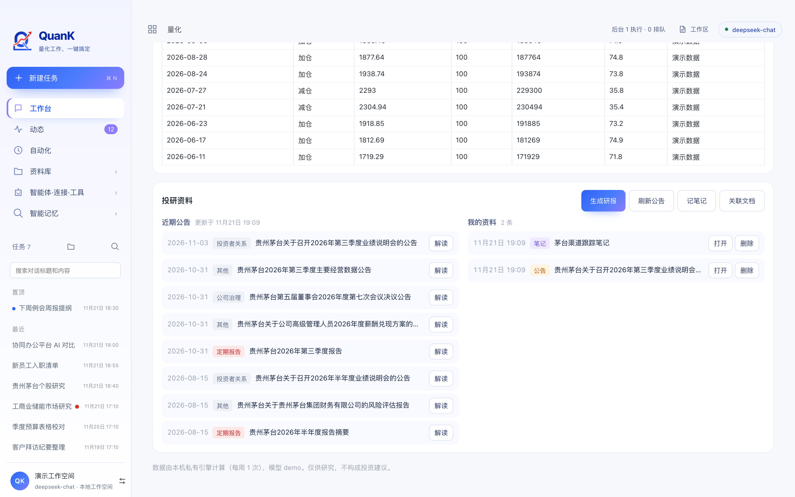 | 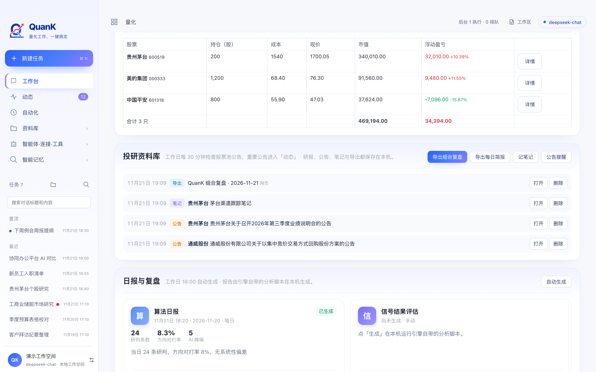 |

*左：个股详情页「投研资料」——近期公告按类型与重要程度标注并摘录要点，「我的资料」按股票归档；右：量化页「投研资料库」——跨股票的研报、公告、笔记与导出，可直接打开或删除。*


*一句话生成的个股研报（网页版）：核心结论、近期公告要点与风险提示；同一份内容还能导出为 Word（附 K 线与收益率图）和 PPT。*

### 投研知识库：检索、财务、关系图与研究主题

- **资料库检索**：研报、公告要点与解读、投研笔记、财务摘要和主题资讯都在本机建索引，按股票或类型筛选，每条结果附原文片段与出处；对话里回答时按 [1][2] 标注来源
- **财报数据库**：每只股票在本机保存最近 30 个报告期的营收、归母净利、毛利率、ROE、负债率等指标，自动推算单季营收与净利润并画趋势图；个股研报自动带「财务数据」章节；可对比多只股票
- **公司关系图**：所属行业、产业链上下游、实际控制人、前十大股东及持股比例、股票池里的同行业公司（点击直接打开）
- **研究主题**：按关键词和关联股票汇集公告、公开资讯和资料库内容，每周自动生成主题周报，进入「动态」并发系统通知

| | |
| --- | --- |
| 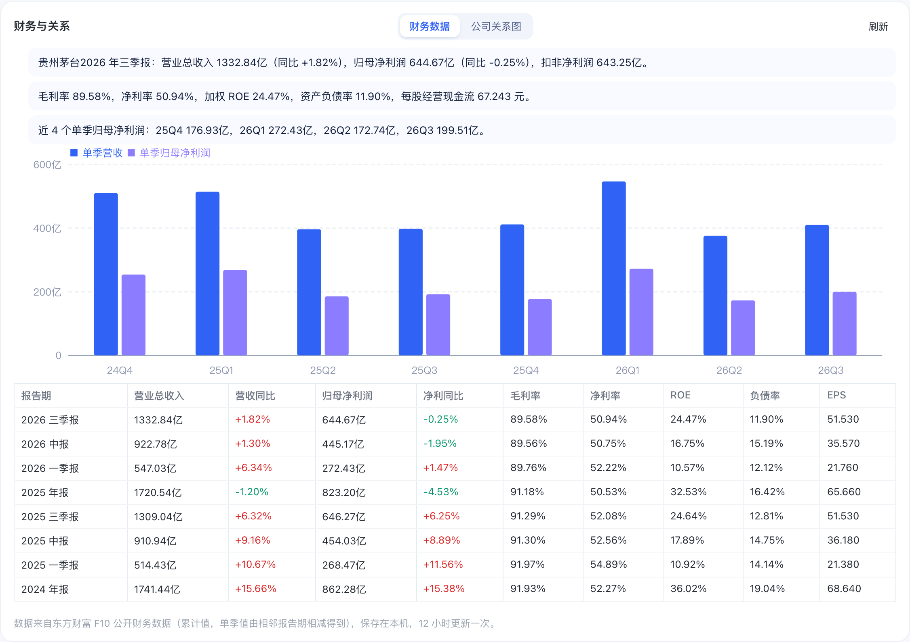 | 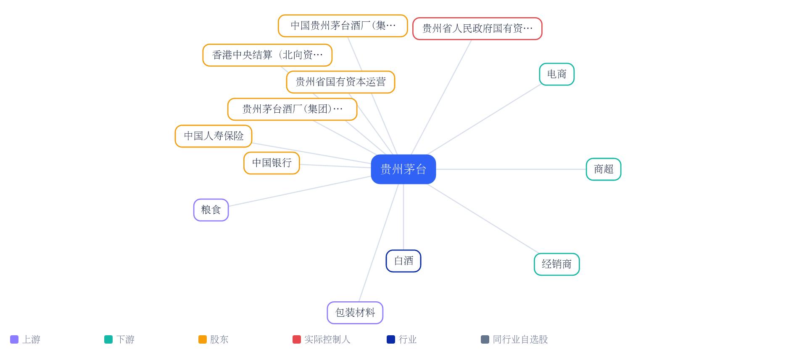 |

*左：个股页「财务与关系 · 财务数据」——一句话财务摘要、单季营收与归母净利润柱状图、近 8 个报告期指标表；右：「公司关系图」——行业、产业链上下游、实际控制人与前十大股东。产业链为按行业预置的通用模板，仅作研究线索。*


*量化页「投研知识库」：在研报、公告、笔记与财务摘要里检索，结果附出处；研究主题每周自动生成周报。*

### 组合与风控：总览、风控提醒、风险指标与压力测试

- **组合总览**：自动汇总量化引擎里记录的持仓，没有在引擎里记录的股票可以手动录入（股数、成本、止损价）；显示总资产、现金、浮动与今日盈亏、各股仓位和行业分布，并按当前持仓回溯近一年的组合市值曲线，与沪深300对比
- **风控提醒**：止损线、单股止损价、止盈线、高点回落止盈、单股与单行业仓位上限、组合回撤线，以及持仓股的风险公告（立案、问询、处罚、质押、减持等）；交易时段按设定间隔检查、收盘后再检查一次，同一条提醒每天只发一次，进入「动态」并发系统通知
- **风险指标**：年化波动率、最大回撤与区间、当前回撤、相对沪深300的 Beta 与相关系数、单日 VaR / CVaR（95%，历史模拟法），个股 Beta 和持仓相关性矩阵
- **压力测试与调仓模拟**：大盘、行业、个股情景下组合会亏多少、谁拖累最大、谁会触发止损；输入几笔调仓，对比调仓前后的仓位、行业分布和风险
- **只提醒，不下单**：所有规则和模拟都只做提醒与计算，QuanK 不会替你下单；也可以在对话里问「我的组合怎么样」「帮我做个压力测试」，或者生成一份组合风控报告（Word / PPT / 网页）

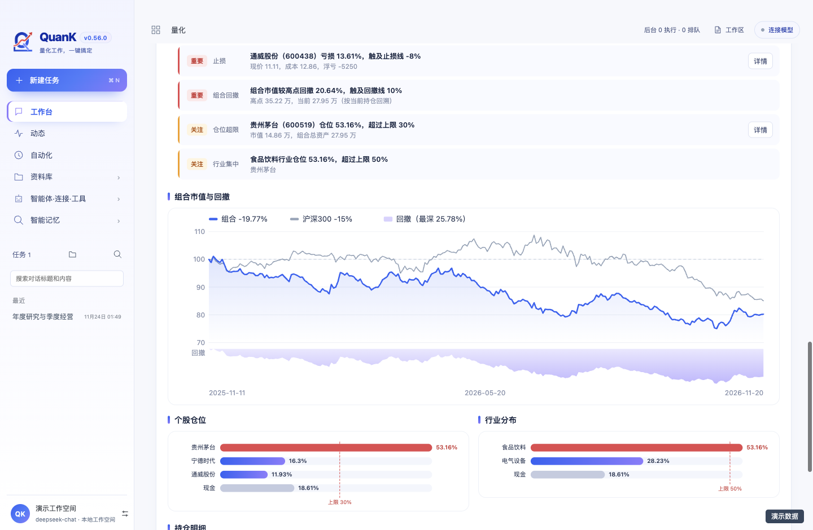

*「组合与风控 · 组合总览」：总资产与盈亏，当前触发的风控提醒（止损、组合回撤、仓位超限、质押公告），按当前持仓回溯的组合市值与回撤（灰线为沪深300），以及个股仓位和行业分布（红色虚线为仓位上限）。示意数据。*

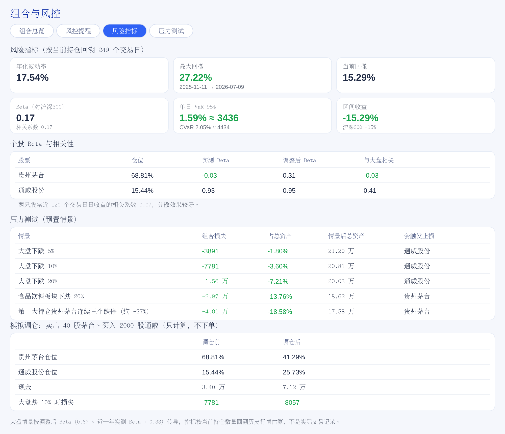

*「风险指标」与「压力测试」：波动率、最大回撤、Beta、VaR，个股调整后 Beta；预置情景的组合损失与会触发止损的股票；模拟调仓前后的仓位与风险对比。示意数据。*

### 安全与合规：数据留在本机，过程有据可查

- **本机数据加密与应用锁**：对话、持仓、组合、笔记、风控规则和设置可以用 AES-256 加密保存，密钥放在 macOS 钥匙串；离开电脑时按闲置时间或系统锁屏自动锁定，用触控 ID 或解锁密码打开
- **加密备份与恢复**：用你设置的密码导出一份加密备份，钥匙串被重置或换电脑时可以完整恢复
- **密钥与外发管控**：一页看清所有模型、MCP 和连接的密钥保存方式，一键测试默认模型密钥是否有效；外发记录列出 QuanK 连过哪些外部服务、发了多少字节（不记内容）；需要时一键离线；对话查询持仓时可以把股数、成本、市值、盈亏替换成 *** 再发给大模型
- **操作审计**：改风控规则、改持仓、记成交、确认框的选择、导出、调用大模型都会记一笔，每条带上一条的校验值，被改动或删除能查出来；可筛选、可导出 CSV
- **合规审阅**：研报、组合报告、主题周报导出前自动补上统一的免责声明和风险提示，检查「保本」「稳赚」「目标价必达」「梭哈」等违规表述，缺少数据来源、日期和 AI 生成标注时给出提示；公众号文章也能贴进来检查，或者在对话里问「这篇能不能发」

### 半自动委托：信号变成委托单，最后一步由你提交

- **委托单**：股票池出现买点 / 卖点、持仓触发止损时，自动生成委托单：买入按「每笔基准金额 × 引擎倍率」计算（默认 5000 元，按 100 股取整，科创板 200 股起），卖点卖出一半、强烈卖出与止损全部卖出；限价为现价 ± 滑点，不超出涨跌停、偏离现价不超过 1.5%。
- **风控前置**：单笔 ≤ 2 万、每日买入 ≤ 5 万、每天最多 5 笔，并按可用现金、单股和行业仓位上限自动缩减；不满足时委托单标为「未通过风控」并写明原因。止损卖出不受每日金额和笔数限制。委托单当天收盘作废。
- **模拟盘（默认）**：按实时行情撮合（买入现价不高于委托价、卖出现价不低于委托价时成交），单独记账，显示总资产与盈亏，可随时重置。
- **真实下单（需你确认风险后切换）**：在内置浏览器里打开券商网页版（预置招商证券），你自己登录；首次在买入、卖出页面各点一遍「代码 / 价格 / 数量 / 提交按钮」完成标注。下单时 QuanK 填好代码、价格、数量，读回核对一致后用红框标出提交按钮，**由你亲自点击提交，QuanK 不会替你点击**。登录只保存在本次运行的内存里。成交后点「回填成交」（可从「当日委托」列表读取），自动记入引擎持仓或手动持仓。
- **随时可停**：一键暂停；每一次下单、回填、撤单、改设置都写入操作审计。对话（「看看今天的委托单」）和命令行 `quank order` 也能查看和操作，同样每一步都要确认。

> 量化信号不保证盈利。按监管规定，使用程序辅助交易可能需要向券商报告，请以券商要求为准。

### 命令行 quank：终端、脚本和其他 AI 工具直接调用 QuanK

在「安全与合规」里点「开启并安装 quank」，就能在终端里使用 QuanK。命令行和对话、界面用的是同一套功能：会修改数据的操作照样在 QuanK 里弹确认框，所有调用都记入操作审计，应用锁定时一律拒绝。

```
quank quote 通威,茅台          # 实时行情
quank signal 通威              # 本机策略信号
quank pf stress --market -10   # 大盘跌 10% 时组合会亏多少
quank kb search 质押 --stock 通威
quank ask "池子里谁是买点，按综合分排序"
cat 草稿.md | quank check      # 发布前合规检查
quank pf --json | jq .total    # 给脚本用
```

- **`quank mcp`**：作为本机 MCP 服务，Claude Desktop、Cursor、Quick 等可以直接调用 QuanK 的 74 个指令和 `quank_ask`；按「发给模型前隐藏金额」的设置打码
- **`quank acp`**：作为 ACP 代理，加进编码代理面板，由别的智能体给 QuanK 派任务，同一个会话保持同一个 QuanK 对话
- 只通过本机套接字连接（只有你的 macOS 账户能访问，不开放网络端口），默认关闭。详见 [命令行指南](docs/guides/CLI.md)

### 金融智能体与投研技能

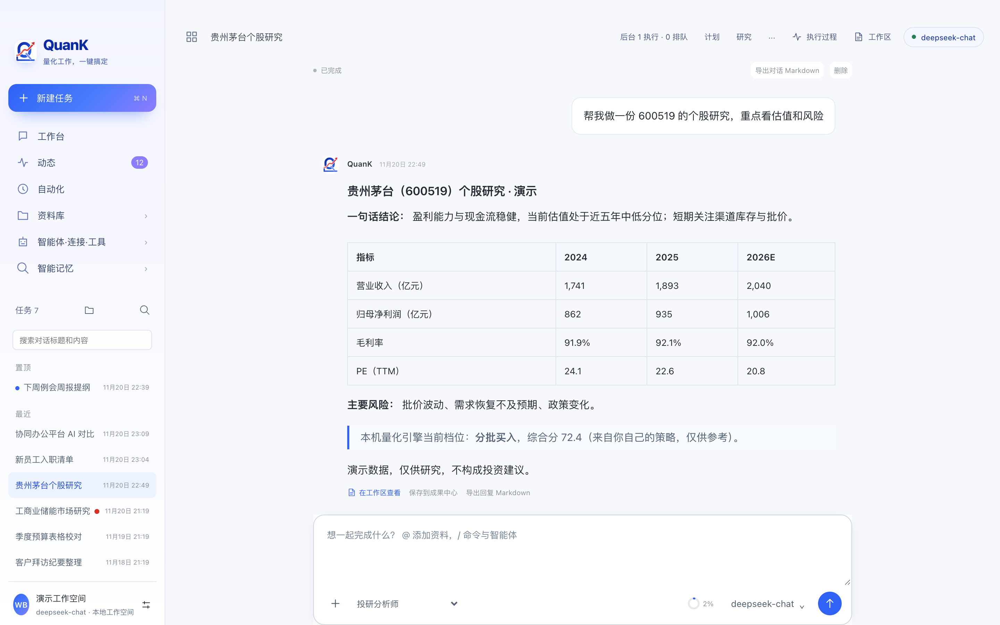

- **4 个金融智能体**：投研分析师 · 财务建模师 · 量化策略助手 · 风控合规官
- **11 个投研技能**：个股研究、财报点评、三表建模、DCF 估值、盘前晨报、组合复盘、合规审阅……
- **一句话完成**：界面上能做的事，都能在对话里一句话完成

| | |
| --- | --- |
|  |  |

### 行情数据接入

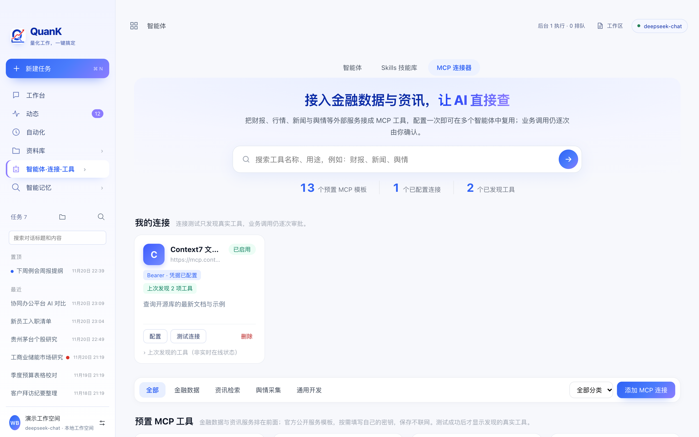

| 数据源 | 覆盖 |
| --- | --- |
| **AKShare One** | A 股行情、个股新闻、财务报表（免 Token） |
| **Tushare Pro** | A 股、指数、基金、期货、债券、宏观 |
| **Alpha Vantage** · **Twelve Data** | 美股、外汇、加密货币、全球指数 |
| **Fiscal.ai** | 上市公司财报、关键指标与估值 |

### 自动化：晨报、日报与定时任务

| | |
| --- | --- |
|  |  |

定时任务按天 / 工作日 / 每周自动运行，结果统一进入「动态」和每日简报；无人值守时，未授权的操作只记录、不执行。

### 智能记忆：知识图谱与记忆库

| | |
| --- | --- |
|  | 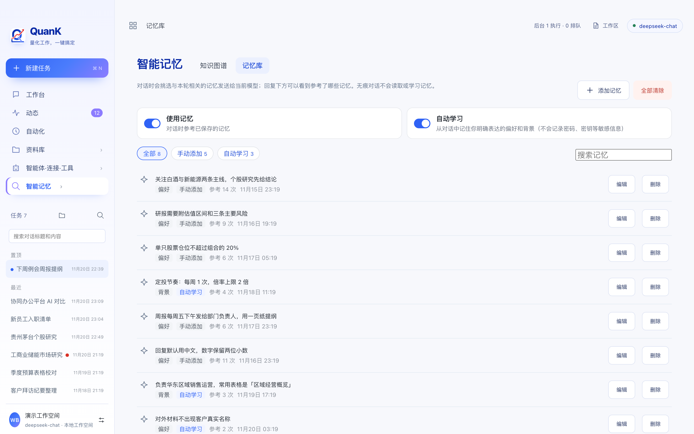 |

- **知识图谱**：从对话、文档、邮件和日历中自动整理人物、公司、项目和它们的关系，对话时自动带入相关背景
- **记忆库**：记住你的偏好、关注方向和工作习惯；回复下显示参考了哪些记忆，自动学到的内容可随时撤销
- **完全可控**：记忆只保存在本机，可搜索、编辑、删除；无痕对话不读也不写记忆

### 深度研究与创作

| | |
| --- | --- |
|  |  |

带引用的深度研究报告、本机生成的交互仪表盘、信息图与海报、一句话生成的小应用。

### 内置 Office 编辑器

| | | |
| --- | --- | --- |
| 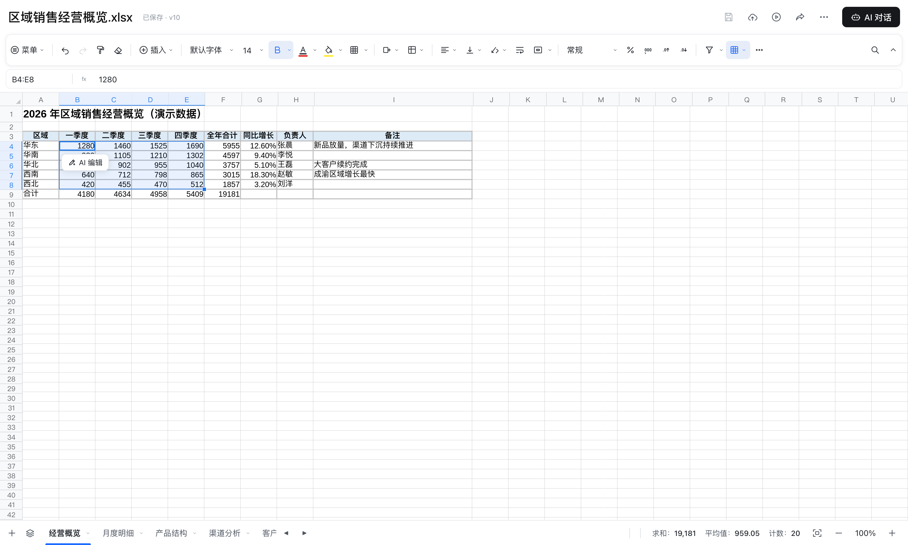 |  |  |

双击 Word / Excel / PPT 即在 QuanK 中编辑：独有的简洁工具栏，AI 对选中内容直接修改，每次保存自动留版本。

## 界面一览

| | |
| --- | --- |
|  |  |
| 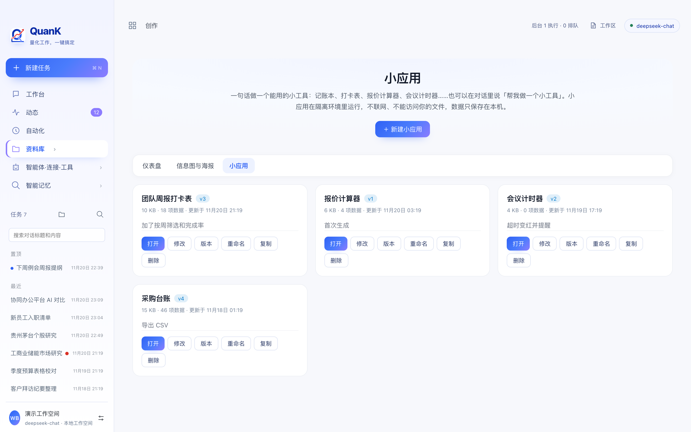 | 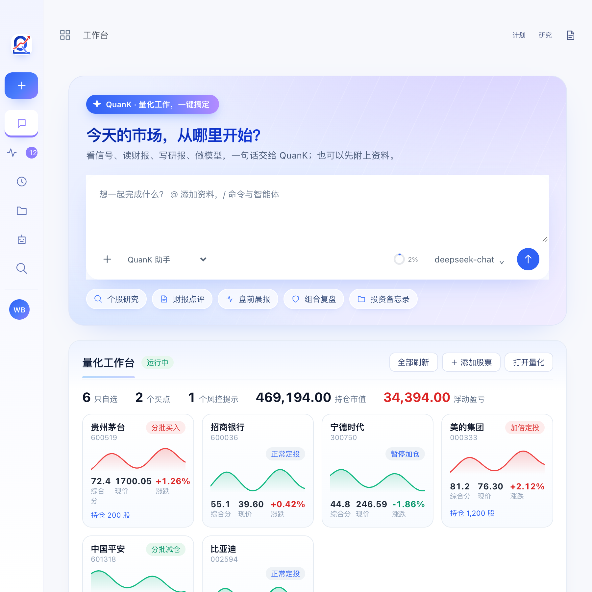 |

## 隐私与安全

- **数据在本机**：对话、文档、持仓与量化数据保存在你的 Mac 上
- **密钥加密**：所有凭据用 macOS 钥匙串加密保存
- **逐次确认**：写文件、运行命令、记录成交等操作都先确认
- **不替你交易**：只读信号、记录成交，从不下单

## 常见问题

**需要另外安装 Office 或 Python 吗？** 不需要，文档引擎与 Python 运行时已内置。

**量化策略从哪里来？** 添加微信 **findingnoone** 获取；QuanK 本身不附带任何策略。

**QuanK 会记住什么？** 你的偏好、关注方向，以及对话里出现的人物、公司和项目；都在「智能记忆」里，可随时编辑或删除。

**提示「无法验证开发者」？** 在「应用程序」里右键 QuanK → 打开，只需一次。

## 从源码运行

```bash
git clone https://github.com/scliubingxin/QuanK.git
cd QuanK/desktop && npm install && npm start
```

更多开发与打包说明见[桌面开发指南](desktop/README.md)。

## 更新记录

- **v0.52** — 半自动委托：买点、卖点、止损自动生成委托单（每笔 5000 元 × 引擎倍率，单笔 / 每日 / 笔数 / 限价偏离上限），默认模拟盘按实时行情撮合；真实下单时在内置浏览器里填好券商网页并标出提交按钮，由你亲自点击提交。下载 `QuanK-v0.52.0-mac-arm64.dmg`。
- **v0.51** — quank 命令行：终端子命令（行情、信号、组合、投研、提醒、审计）、`quank ask` 一句话让智能体做事、`quank mcp` 作为 MCP 服务、`quank acp` 作为编码代理接入。下载 `QuanK-v0.51.0-mac-arm64.dmg`。
- **v0.50** — F5 合规安全：本机数据加密与应用锁、加密备份与恢复、密钥总览与模型密钥测试、外发记录与离线模式、发给模型前隐藏金额、不可篡改的操作审计、导出前合规审阅与统一免责声明。下载 `QuanK-v0.50.0-mac-arm64.dmg`。
- **v0.49.1** — 修复：个股页「财务与关系」「投研资料」与量化页「投研资料库」「投研知识库」「组合与风控」提示「当前窗口缺少此功能接口」。下载 `QuanK-v0.49.1-mac-arm64.dmg`。
- **v0.49** — F4 组合与风控：组合总览与行业分布、止损 / 止盈 / 回撤 / 仓位风控提醒、波动率 / 回撤 / Beta / VaR 风险指标、压力测试与调仓模拟（只提醒、只计算，不下单）。下载 `QuanK-v0.49.0-mac-arm64.dmg`。
- **v0.48** — F3 投研知识库：资料库检索（附出处）、财报数据库与单季趋势、公司与产业链关系图、研究主题周报。下载 `QuanK-v0.48.0-mac-arm64.dmg`。
- **v0.47.1** — K 线在东方财富接口受限时自动改用腾讯行情；回测收益率与策略收益统一口径（含储备金）。
- **v0.47** — F2 投研文档：一句话个股研报（Word/PPT/网页）、公告分类解读与提醒、研究资料库、复盘与简报导出。下载 `QuanK-v0.47.0-mac-arm64.dmg`。
- **v0.46** — F1 行情工作台：首页市场行情卡片与完整行情页（指数、涨跌家数、涨跌幅榜、板块热力图、价格提醒）；纯 SVG K 线（日 / 周 / 月 / 60 分 / 分时 + MA / MACD / KDJ / 成交量）；自选股实时价与涨跌停异动提醒；个股详情标出回测买卖点、回测收益率改为智能定投与普通定投对比；输入框 @ 与 / 菜单不再被首页卡片裁切。下载 `QuanK-v0.46.0-mac-arm64.dmg`。
- **v0.45** — 更名 QuanK 独立发布；全新首页工作台与走势线；4 个金融智能体与 11 个投研技能；行情数据源支持浏览器登录与本机程序接入；持仓定投、盯盘提醒与收盘日报；DMG 一键安装（`QuanK-0.45.0-arm64.dmg`）。
- **v0.44** 及更早版本见 [WillBuddy](https://github.com/scliubingxin/WillBuddy/releases)。

每个版本的打包与发布记录（校验值、提交、tag）见 [docs/releases](docs/releases/README.md)；文档目录说明见 [docs/README.md](docs/README.md)。

## 许可与声明

源码以 [Apache License 2.0](LICENSE) 开源。私有量化策略不在本仓库中。QuanK 提供的信号、研判与报告仅供研究参考，不构成投资建议；投资有风险，决策请独立判断。

---

<sub><b>English</b> · QuanK is a local-first finance & quant workstation for Apple Silicon Macs: run your own strategy locally, use finance agents and research skills, connect market data, automate briefs and reports, and edit Word / Excel / PowerPoint files. Bring any OpenAI-compatible model. Licensed under Apache-2.0. <a href="https://github.com/scliubingxin/QuanK/releases/latest">Download</a></sub>
