<div align="center">
  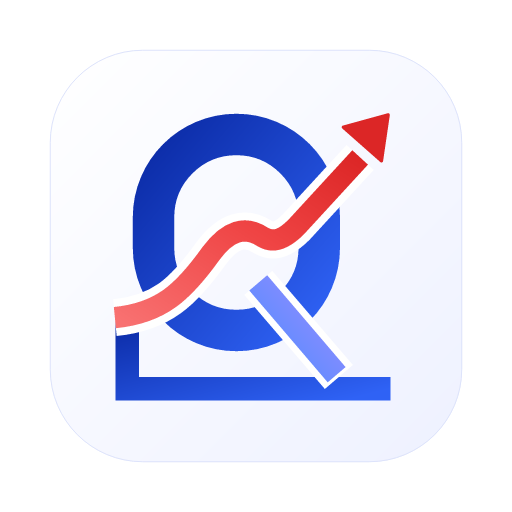
  <h1>QuanK</h1>
  <p><b>量化工作，一键搞定</b></p>
  <p>本地优先的金融量化 Mac 工作台 · 你的策略，在你的电脑上跑</p>
  <p>
    
    
    
  </p>
  <p>
    <a href="https://github.com/scliubingxin/QuanK/releases/latest"><b>⬇ 下载 DMG</b></a> ·
    <a href="#一分钟看懂-quank">演示视频</a> ·
    <a href="#获取量化策略">获取量化策略</a> ·
    <a href="#核心能力">核心能力</a>
  </p>
</div>

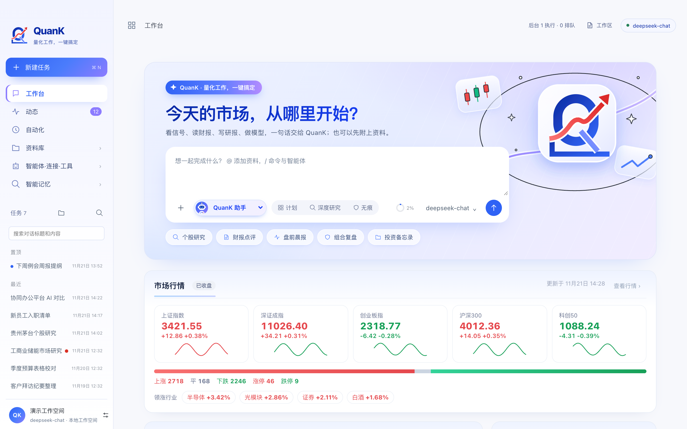

<table>
<tr>
<td width="20%" valign="top"><b>🖥 本机运行</b><br>策略、持仓、回测都在你的电脑上计算，策略代码不出本机</td>
<td width="20%" valign="top"><b>🤖 金融智能体</b><br>投研、建模、量化、风控 4 个智能体，11 个投研技能</td>
<td width="20%" valign="top"><b>📡 行情数据</b><br>A 股与全球行情、财报数据，一句话接入</td>
<td width="20%" valign="top"><b>⏰ 自动盯盘</b><br>盘前晨报、收盘日报、信号变化即时提醒</td>
<td width="20%" valign="top"><b>🧠 智能记忆</b><br>知识图谱与记忆库，越用越懂你的投研习惯</td>
</tr>
</table>

## 一分钟看懂 QuanK

[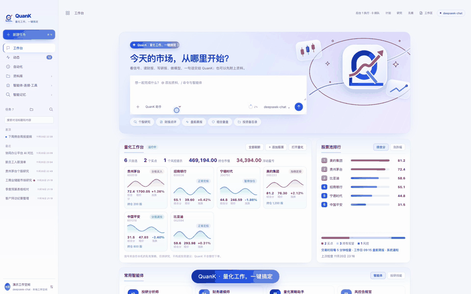](docs/media/quank-demo.mp4)

## 获取量化策略

<table>
<tr>
<td width="200"></td>
<td valign="middle">
<b>添加微信 <code>findingnoone</code></b><br><br>
获取量化策略、接入指导和使用支持。<br>
拿到策略后，在 QuanK「量化」页点「导入策略项目」即可开始使用。
</td>
</tr>
</table>

## 下载与安装

**系统要求**：Apple 芯片（M1 及以上）Mac，macOS 12 或更新版本。前往 [Releases](https://github.com/scliubingxin/QuanK/releases/latest) 下载 **`QuanK-v0.46.0-mac-arm64.dmg`**。

1. 双击 DMG，把 **QuanK** 拖到 **应用程序**。
2. 首次打开：在「应用程序」里右键 QuanK → 打开（只需一次）。
3. 左下角「模型设置」填入模型服务地址和 API Key（DeepSeek、通义、Kimi、本机 Ollama 均可）。

> 从 WillBuddy 升级：首次打开会自动迁移对话、记忆、任务和量化数据。

## 核心能力

### 量化工作台：在本机运行你的策略

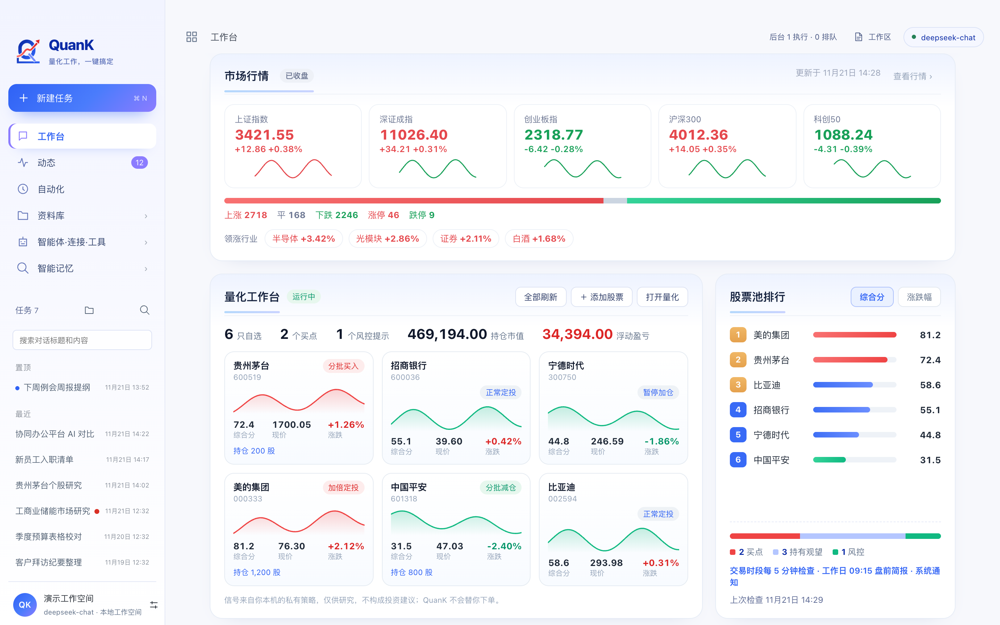

- **一屏看全**：自选信号、持仓盈亏、近 60 日走势，股票池按综合分排行
- **个股详情**：档位与理由、因子得分、回测收益曲线
- **持仓与定投**：记录真实成交，调整定投节奏，QuanK 从不替你下单
- **盯盘与日报**：信号变化即时通知，收盘自动生成算法日报
- **一句话加自选**：在对话里说「添加宁德时代」，自动联网查代码、名称和公司标志
- **获取策略**：添加微信 **findingnoone**

| | |
| --- | --- |
|  |  |
| 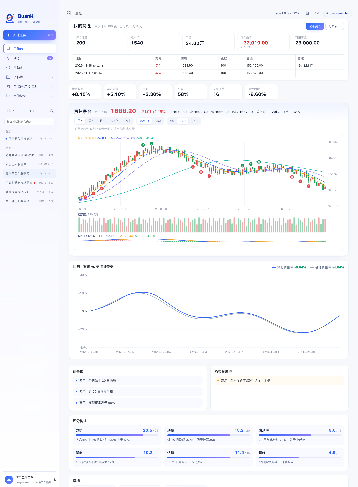 |  |

### 行情工作台：指数、板块与 K 线

- **大盘一屏看全**：首页「市场行情」卡片显示上证、深证、创业板、沪深300、科创50，以及涨跌家数、涨跌停数，交易时段每 10 秒刷新
- **行情页**：涨跌幅榜、行业 / 概念板块热力图（点开看成分股）、价格提醒
- **K 线图**：日 / 周 / 月 / 60 分钟 / 分时，均线、成交量、MACD、KDJ；量化详情页标出策略买卖点
- **自选股实时价**：股票池卡片显示实时价格，涨跌停与大幅异动自动提醒
- **一句话查行情**：「上证现在多少点」「今天哪个板块最强」「宁德时代周 K 线」「宁德时代涨超 5% 提醒我」

| | |
| --- | --- |
|  |  |

*左：个股 K 线，日 K 上标出回测买卖点——红 B 为买入、绿 S 为卖出，悬停显示日期、价格、股数与原因，切到周 K / 月 K 时买卖点自动对齐；右：回测收益率对比，智能定投（策略）与普通定投（基准）两条曲线同图对比，带 0% 基准线。*

### 金融智能体与投研技能


- **4 个金融智能体**：投研分析师 · 财务建模师 · 量化策略助手 · 风控合规官
- **11 个投研技能**：个股研究、财报点评、三表建模、DCF 估值、盘前晨报、组合复盘、合规审阅……
- **一句话完成**：界面上能做的事，都能在对话里一句话完成

| | |
| --- | --- |
|  |  |

### 行情数据接入


| 数据源 | 覆盖 |
| --- | --- |
| **AKShare One** | A 股行情、个股新闻、财务报表（免 Token） |
| **Tushare Pro** | A 股、指数、基金、期货、债券、宏观 |
| **Alpha Vantage** · **Twelve Data** | 美股、外汇、加密货币、全球指数 |
| **Fiscal.ai** | 上市公司财报、关键指标与估值 |

### 自动化：晨报、日报与定时任务

| | |
| --- | --- |
| 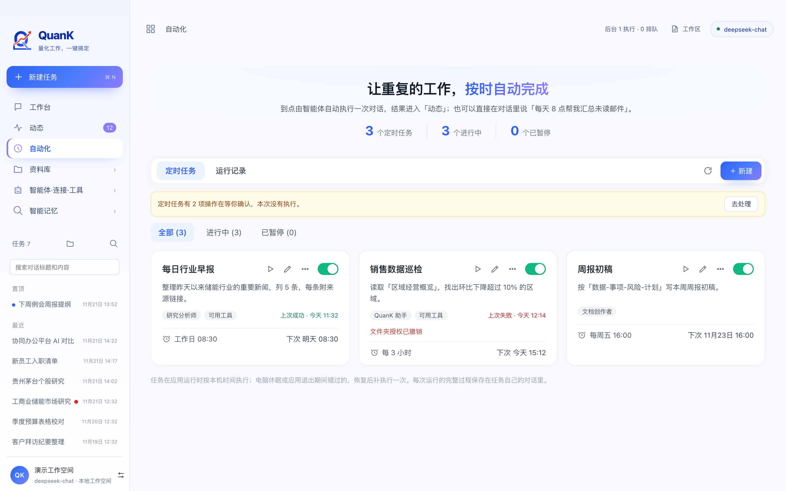 |  |

定时任务按天 / 工作日 / 每周自动运行，结果统一进入「动态」和每日简报；无人值守时，未授权的操作只记录、不执行。

### 智能记忆：知识图谱与记忆库

| | |
| --- | --- |
| 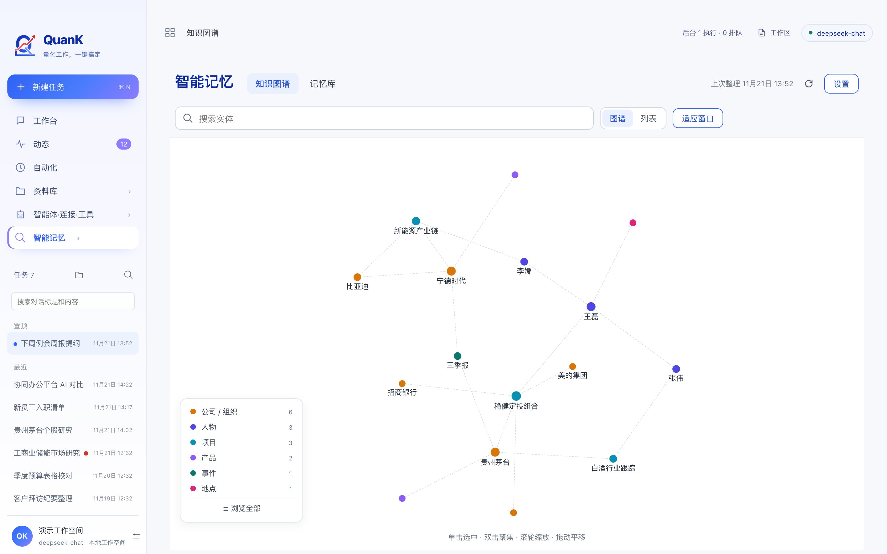 |  |

- **知识图谱**：从对话、文档、邮件和日历中自动整理人物、公司、项目和它们的关系，对话时自动带入相关背景
- **记忆库**：记住你的偏好、关注方向和工作习惯；回复下显示参考了哪些记忆，自动学到的内容可随时撤销
- **完全可控**：记忆只保存在本机，可搜索、编辑、删除；无痕对话不读也不写记忆

### 深度研究与创作

| | |
| --- | --- |
| 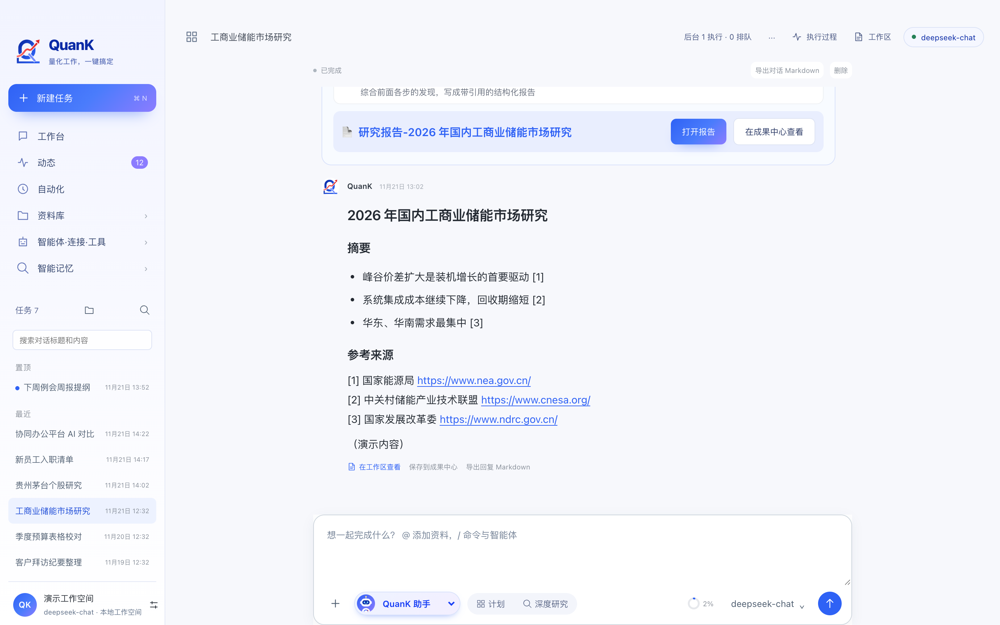 | 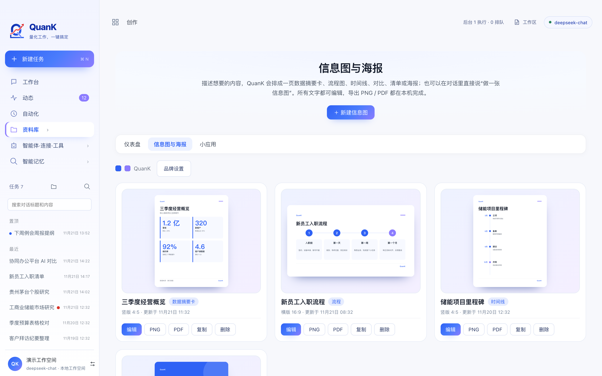 |

带引用的深度研究报告、本机生成的交互仪表盘、信息图与海报、一句话生成的小应用。

### 内置 Office 编辑器

| | | |
| --- | --- | --- |
|  | 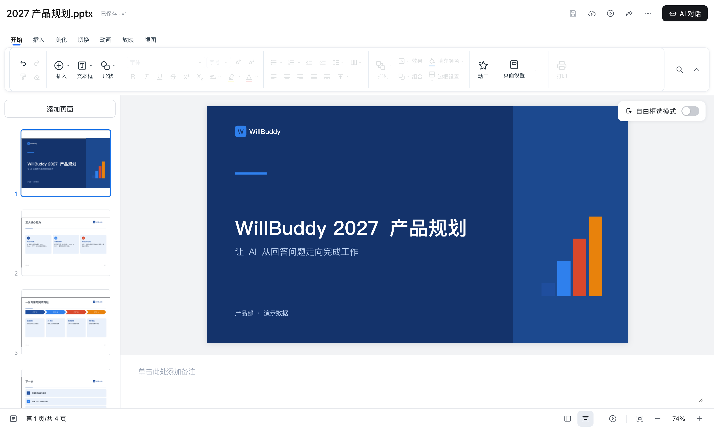 | 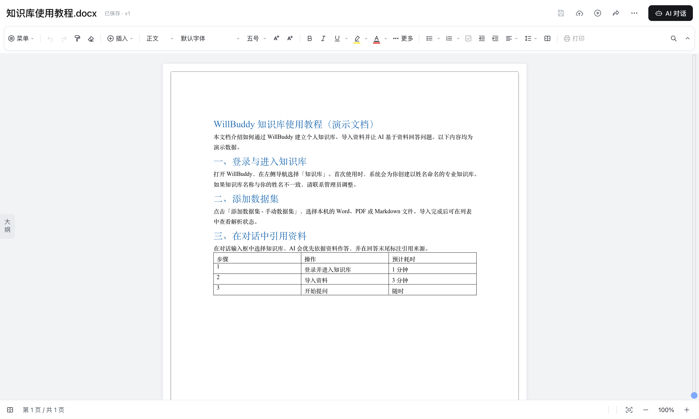 |

双击 Word / Excel / PPT 即在 QuanK 中编辑：独有的简洁工具栏，AI 对选中内容直接修改，每次保存自动留版本。

## 界面一览

| | |
| --- | --- |
| 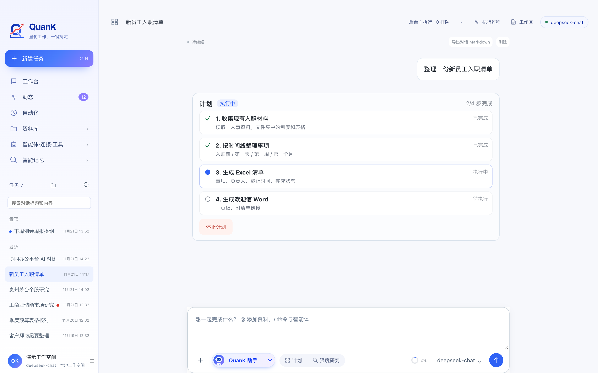 |  |
|  |  |

## 隐私与安全

- **数据在本机**：对话、文档、持仓与量化数据保存在你的 Mac 上
- **密钥加密**：所有凭据用 macOS 钥匙串加密保存
- **逐次确认**：写文件、运行命令、记录成交等操作都先确认
- **不替你交易**：只读信号、记录成交，从不下单

## 常见问题

**需要另外安装 Office 或 Python 吗？** 不需要，文档引擎与 Python 运行时已内置。

**量化策略从哪里来？** 添加微信 **findingnoone** 获取；QuanK 本身不附带任何策略。

**QuanK 会记住什么？** 你的偏好、关注方向，以及对话里出现的人物、公司和项目；都在「智能记忆」里，可随时编辑或删除。

**提示「无法验证开发者」？** 在「应用程序」里右键 QuanK → 打开，只需一次。

## 从源码运行

```bash
git clone https://github.com/scliubingxin/QuanK.git
cd QuanK/desktop && npm install && npm start
```

更多开发与打包说明见[桌面开发指南](desktop/README.md)。

## 更新记录

- **v0.46** — F1 行情工作台：首页市场行情卡片与完整行情页（指数、涨跌家数、涨跌幅榜、板块热力图、价格提醒）；纯 SVG K 线（日 / 周 / 月 / 60 分 / 分时 + MA / MACD / KDJ / 成交量）；自选股实时价与涨跌停异动提醒；个股详情标出回测买卖点、回测收益率改为智能定投与普通定投对比；输入框 @ 与 / 菜单不再被首页卡片裁切。下载 `QuanK-v0.46.0-mac-arm64.dmg`。
- **v0.45** — 更名 QuanK 独立发布；全新首页工作台与走势线；4 个金融智能体与 11 个投研技能；行情数据源支持浏览器登录与本机程序接入；持仓定投、盯盘提醒与收盘日报；DMG 一键安装（`QuanK-0.45.0-arm64.dmg`）。
- **v0.44** 及更早版本见 [WillBuddy](https://github.com/scliubingxin/WillBuddy/releases)。

## 许可与声明

源码以 [Apache License 2.0](LICENSE) 开源。私有量化策略不在本仓库中。QuanK 提供的信号、研判与报告仅供研究参考，不构成投资建议；投资有风险，决策请独立判断。

---

<sub><b>English</b> · QuanK is a local-first finance & quant workstation for Apple Silicon Macs: run your own strategy locally, use finance agents and research skills, connect market data, automate briefs and reports, and edit Word / Excel / PowerPoint files. Bring any OpenAI-compatible model. Licensed under Apache-2.0. <a href="https://github.com/scliubingxin/QuanK/releases/latest">Download</a></sub>
